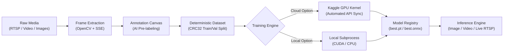

# YOLOFlow Studio

[](https://fastapi.tiangolo.com)
[](https://react.dev/)
[](https://vitejs.dev/)
[](https://tailwindcss.com/)
[](https://github.com/ultralytics/ultralytics)
[](https://www.python.org/)

An end-to-end, zero-database computer vision studio running entirely in the browser. Ingest live RTSP streams or video files, extract frames, annotate with AI pre-labeling assistance, train custom YOLO models on Kaggle cloud GPUs or locally, and evaluate detections in real time.

---

## 🌟 Key Features

- **Multi-Source Ingestion**: Drag-and-drop photos/videos, or connect live RTSP IP cameras and local webcams (`0`) with background recording via OpenCV.
- **Smart Frame Extraction**: Configurable frame sampling (custom FPS or every N-th frame) with real-time SSE progress streaming.
- **Canvas Annotation Suite**: Interactive bounding box creation, editing, and resizing with keyboard shortcuts (`?`), 80 COCO classes, and custom class support.
- **AI Pre-Labeling**: Accelerate dataset labeling using dashed bounding-box suggestions from pretrained COCO weights or previously trained custom runs.
- **Dual Training Engine**:
  - **Cloud (Kaggle)**: 1-click dataset upload, automated private GPU kernel execution, and weight retrieval via the Kaggle API.
  - **Local**: Subprocess-based training supporting CUDA GPUs and CPUs with live log streaming.
- **Live Telemetry & Evaluation**: Real-time epoch tracking, mAP/precision/recall graphs, confusion matrices, loss curves, and artifact downloads (`best.pt`, `best.onnx`).
- **Interactive Inference Playground**:
  - Test on static images with downloadable annotated overlays.
  - Test on video files with server-side H.264 / VP8 encoding and browser playback.
  - Live RTSP stream inference with adjustable confidence/IoU sliders and real-time class counters.
- **Zero-Database Architecture**: Flat-file storage under `workspace/` with deterministic CRC32 train/val splitting to eliminate data leakage.

---

## 🛠️ Technologies Used

| Layer | Technologies |
| :--- | :--- |
| **Frontend** | React 18, Vite 6, Tailwind CSS v4, Lucide React, Sonner, HTML5 Canvas API |
| **Backend** | Python 3.10+, FastAPI, Uvicorn, OpenCV (`cv2`), Server-Sent Events (SSE), PyYAML |
| **Machine Learning** | Ultralytics YOLO (v8, v9, v10, v11, v12, v26), PyTorch, ONNX Runtime |
| **Cloud & DevOps** | Kaggle API (Automated GPU kernels & dataset versioning), PowerShell & Bash launcher scripts |

---

## 🏗️ Architecture & How It Works



### Core Design Principles

1. **Zero-Database Reliability**: All projects, annotations, and training runs reside as structured files (`project_meta.json`, `data.yaml`, label text files) inside `workspace/`. You can copy, backup, or inspect your dataset directly in the file explorer.
2. **Deterministic Data Splitting**: Images are placed into train and validation sets (approx. 80/20) using a CRC32 hash of the image filename. Images never switch splits when re-saved or edited.
3. **Automated Kaggle Bridge**: When training on Kaggle, the backend zips the dataset, creates/updates a private Kaggle dataset, spawns a dedicated Kaggle notebook kernel with GPU enabled, and polls status until completion to download the generated weights.

---

## 📁 Storage Layout

```
workspace/
├── config.json                     # Kaggle credentials and default hyperparameters
├── models/                         # Cached official weights (yolo11n.pt, yolov8n.pt, etc.)
│   └── custom/                     # Uploaded user models (.pt / .onnx)
└── projects/{project_name}/
    ├── project_meta.json           # Classes, media registry, timestamps
    ├── raw_media/                  # Original photos, uploaded videos, RTSP recordings
    ├── extracted_frames/           # Individual frame captures
    ├── dataset/
    │   ├── data.yaml               # YOLO dataset configuration
    │   ├── images/{train,val}/     # Deterministically partitioned images
    │   └── labels/{train,val}/     # Normalized YOLO format annotations (class x y w h)
    ├── outputs/{run_id}/
    │   ├── run.json, train.log     # Execution metadata and training logs
    │   └── artifacts/              # best.pt, best.onnx, metrics, and plots
    └── inference/{result_id}/      # Output videos and inference summaries
```

---

## 🚀 Getting Started

### Prerequisites

- **Python**: 3.10 or 3.11 installed and added to PATH
- **Node.js**: v18+ and `npm`
- **Git**

### Installation

1. **Clone the repository:**
   ```bash
   git clone <repo-url>
   cd Yolo_Trainer
   ```

2. **Set up Python Virtual Environment (Backend):**
   ```bash
   cd backend
   python -m venv venv

   # Activate virtual environment
   # Windows (PowerShell):
   .\venv\Scripts\Activate.ps1
   # Linux / macOS:
   source venv/bin/activate

   # Install dependencies
   pip install -r requirements.txt
   cd ..
   ```

3. **Install Frontend Dependencies:**
   ```bash
   cd frontend
   npm install
   cd ..
   ```

---

## 💻 Running the Application

### Option A: Development Mode (Hot Reload)

Launch both the FastAPI backend and Vite frontend with a single command:

- **Windows (PowerShell):**
  ```powershell
  .\start.ps1
  ```
- **Linux / macOS:**
  ```bash
  chmod +x start.sh
  ./start.sh
  ```

Or start them manually in two terminals:
- **Terminal 1 (Backend):**
  ```bash
  cd backend
  # Ensure venv is activated
  python -m uvicorn main:app --reload --port 8000
  ```
- **Terminal 2 (Frontend):**
  ```bash
  cd frontend
  npm run dev
  ```
Access the application at `http://localhost:5173`.

### Option B: Production Mode (Single Process)

Build the frontend static assets and serve directly through FastAPI:

```bash
cd frontend
npm run build
cd ../backend
python -m uvicorn main:app --port 8000
```
Open `http://127.0.0.1:8000` in your browser.

---

## ⚡ Step-by-Step Workflow

1. **Create Project**: Enter a project name and define your custom detection classes.
2. **Ingest Media**: Upload video files, drop image batches, or stream directly from an RTSP camera or webcam.
3. **Extract Frames**: Select sampling rate (e.g., 1 frame/sec) to generate annotation candidates.
4. **Annotate**: Label frames using the canvas tool. Toggle AI Pre-Labeling to let a baseline model draft bounding boxes automatically.
5. **Train**:
   - **Kaggle**: Enter your Kaggle API key (found in `kaggle.json`), pick a YOLO architecture (v8–v12), and launch GPU training in the cloud.
   - **Local**: Select your local GPU/CPU and train directly on your machine.
6. **Evaluate & Infer**: Inspect precision/recall curves and confusion matrices, then test your trained `best.pt` on uploaded images, videos, or live RTSP streams.

---

## 📖 API Documentation

Interactive OpenAPI / Swagger docs are automatically available at:
```
http://127.0.0.1:8000/docs
```

Key endpoint groups:
- `/api/projects`: Project lifecycle management
- `/api/media`: Stream ingestion, webcam capture, and frame extraction
- `/api/annotations`: Bounding box read/write operations
- `/api/autolabel`: AI-assisted pre-labeling predictions
- `/api/models`: Model registry and custom `.pt`/`.onnx` verification
- `/api/inference`: Real-time image, video, and live RTSP evaluation
- `/api/jobs`: Background task orchestration with SSE progress streams
